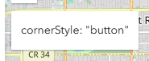
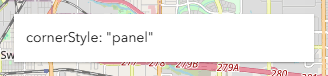
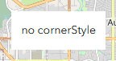

# Look and feel

Components should look like the rest of the viewer, in light and dark mode, and in an app with
its own theme color. The way to get that is to build from the same parts the viewer uses.

## Calcite only

Use [Calcite components](https://developers.arcgis.com/calcite-design-system/components/) for
UI, such as `calcite-block`, `calcite-button`, `calcite-input-text` and `calcite-list`, and
[Calcite icons](https://developers.arcgis.com/calcite-design-system/icons/). Don't add other
component libraries or icon fonts.

Import each Calcite component you use, once, at the top of your element's file. The import
defines the element:

```ts
import "@esri/calcite-components/components/calcite-block";
import "@esri/calcite-components/components/calcite-button";
```

## Design tokens

For your own styles, use Calcite's design tokens instead of fixed colors and sizes:

```ts
const STYLE = `
  :host { display: block; }
  p { margin: 0; color: var(--calcite-color-text-1); font-size: var(--calcite-font-size--1); }
  .hint { color: var(--calcite-color-text-3); }
  .row { display: flex; gap: var(--calcite-spacing-sm); padding: var(--calcite-spacing-md); }
  .card { background: var(--calcite-color-foreground-1); border: 1px solid var(--calcite-color-border-3); }
`;
```

Tokens reach inside your shadow DOM, because CSS custom properties are inherited. Commonly used:

| For | Tokens |
|---|---|
| Text | `--calcite-color-text-1` (main), `-2`, `-3` (quieter) |
| Backgrounds | `--calcite-color-foreground-1`, `-2`, `-3`, `--calcite-color-background` |
| Borders | `--calcite-color-border-1`, `-2`, `-3` |
| Status | `--calcite-color-status-info`, `-success`, `-warning`, `-danger` |
| Spacing | `--calcite-spacing-xxs` to `--calcite-spacing-xxxl` |
| Type | `--calcite-font-size--2` to `--calcite-font-size-2`, `--calcite-font-weight-medium` |

Don't use the viewer's own `--viewer-*` properties: they aren't part of the [viewer API](../viewer-api.md)
and can change.

## Light and dark mode

The viewer switches modes with a `calcite-mode-light`, `calcite-mode-dark` or `calcite-mode-auto`
class on `<html>`, from the app's `app.mode` setting or the user's choice in Settings. Calcite's
tokens follow it, so a component that uses only tokens needs no code for dark mode. Check yours
in both: open Settings in the sidebar and switch the mode.

If you draw on a canvas or need a color in code, let CSS resolve the token, then read the result
when you draw. Reading the token itself gives a `light-dark(...)` expression, not a color:

```ts
// In your stylesheet: .ink { color: var(--calcite-color-text-1); }
const color = getComputedStyle(this.shadowRoot!.querySelector(".ink")!).color; // "rgb(20, 20, 20)" in light mode
```

## In a map corner

A component placed straight into a map corner sits on the map, with no container around it.
Give it a background (`--calcite-color-foreground-1`), and choose how the viewer frames it with
the manifest's [`cornerStyle`](../manifest.md#cornerstyle):

| `cornerStyle` | What it adds | Use for |
|---|---|---|
| `"button"` | The shadow the SDK gives its own buttons, such as Home | Small controls: a button, a toggle, a one-line readout |
| `"panel"` | That shadow, plus a panel's width (about 300 px), scrolling, and sharing the corner's height | Anything with a list, a form or several lines, like a Legend in a corner |
| none | Nothing: the component looks only as its own styles make it | Components that frame themselves, or that sit on the map without a box |







With `"panel"`, the width includes your padding, so add padding inside rather than worrying
about the outside size. When a corner's components are taller than the map, panel-style ones
shrink to fit and scroll.

Behind an expand button, the button gets the button look. Your component opens in the expand's
popover, and a `"panel"` component gets the panel's width there too. On a small map, the
popover becomes a sheet across the bottom: check your component at phone size (375 px wide).

## In a sidebar panel

The sidebar panel supplies the heading, the close button and the scrolling. Your element fills
the panel's width. Leave out a heading of your own, and use `calcite-block` or plain padding
(`--calcite-spacing-md`) for sections.
